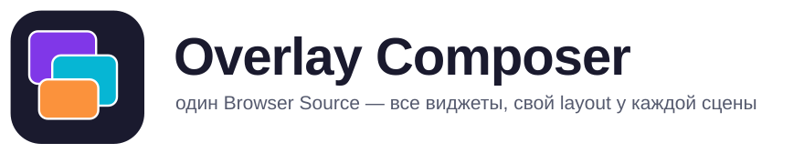
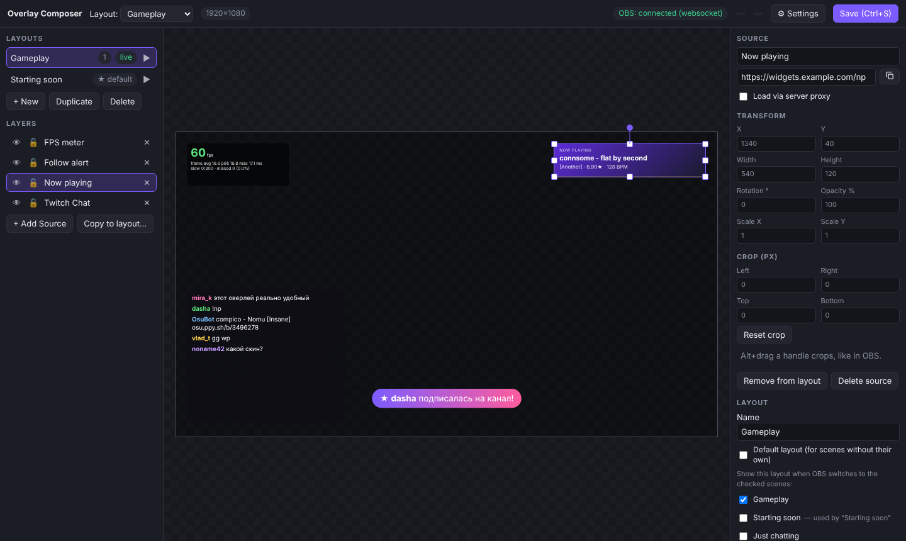
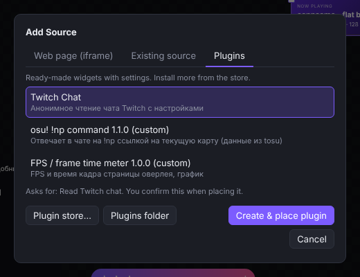
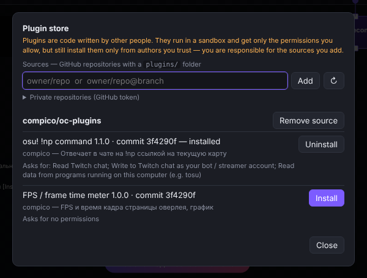
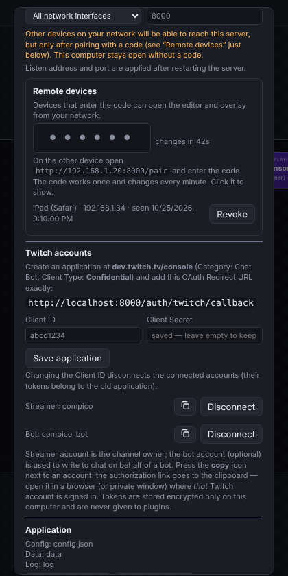

<p align="center">
  <picture>
    <source media="(prefers-color-scheme: dark)" srcset="docs/img/banner-dark.svg">
    
  </picture>
</p>

Один Browser Source в OBS показывает все ваши виджеты (алерты, чат, виджеты донатов…), а **своё расположение виджетов у каждой сцены OBS** вы настраиваете в удобном редакторе. Не нужно держать десяток Browser Source в каждой сцене.

## Как это работает
1. Запускаете программу — в трее появляется значок, в браузере открывается редактор (`http://127.0.0.1:8000/editor`).
2. В OBS добавляете **один** Browser Source с адресом `http://127.0.0.1:8000/overlay`, размером как ваш холст (например, 1920×1080), во всех нужных сценах.
3. В редакторе добавляете виджеты (источники) и расставляете их в **layout**. Каждой сцене OBS соответствует один layout; сцена без своего layout показывает layout «по умолчанию».
4. Переключаете сцену в OBS — overlay сам показывает нужный layout.

## Скриншоты

> Скриншоты сняты на тестовых данных (виджеты-заглушки), чтобы не светить настоящие токены и каналы.

**Редактор.** Layout на холсте 1920×1080, слои, свойства выбранного слоя (положение, поворот, прозрачность, обрезка), привязка layout к сценам OBS. Адреса виджетов с токенами в списках и в свойствах скрываются после `?`.



**Add Source** — три вкладки: страница по адресу (iframe), уже созданный источник и плагины-виджеты. **Магазин плагинов** ставит плагины из репозиториев GitHub.

<p>
  
  
</p>

**Настройки.** Доступ с других устройств (код сопряжения скрыт, пока не нажать на него) и аккаунты Twitch (ссылка авторизации копируется в буфер обмена иконкой).



## Быстрый старт
1. Запустите `overlay-composer` (Windows: `overlay-composer-windows-amd64.exe`, консоль не появляется — управление из трея).
2. В редакторе: **+ Add Source** — три вкладки: **Web page (iframe)** (по умолчанию: адрес виджета, как в Browser Source, имя, размер), **Existing source** (уже созданный источник) и **Plugins** (готовые виджеты, оттуда же открывается магазин).
3. Поставьте виджет на layout, перетащите, растяните, поверните, задайте прозрачность. Сохранение — **Save (Ctrl+S)**.
4. Привяжите layout к сцене OBS (список «Layout → сцены»), нужный layout можно отметить как «по умолчанию».
5. В OBS: Browser Source → URL `http://127.0.0.1:8000/overlay`, ширина/высота как у холста.

### Подключение к OBS (по желанию, но удобно)
Чтобы программа знала список сцен и текущую сцену, включите obs-websocket в OBS (Инструменты → Настройки WebSocket-сервера) и в программе откройте **⚙ Settings** → введите `OBS WebSocket URL` (обычно `ws://127.0.0.1:4455`) и пароль. Без этого сцены сообщает сам Browser Source — для этого в его настройках поставьте «Page permissions» не ниже «Read access to OBS status information».

### Импорт сцены из OBS
**⚙ Settings → Import from OBS** → выберите сцену → **Import as layout**. Для каждого Browser Source создаётся виджет и слой с тем же размером, положением, поворотом, порядком и видимостью (группы и вложенные сцены разворачиваются). Внешние сайты подключаются через прокси, `localhost`/`127.0.0.1` — напрямую. Не переносятся: обрезка (crop; задайте в редакторе), отражение, фильтры, локальные файлы и не-браузерные источники — они перечислены в отчёте.

### Доступ с других устройств
С этого компьютера (`127.0.0.1`) редактор и оверлей открыты без авторизации. Чтобы подключиться с другого устройства (планшет, телефон):
1. Settings → **Listen on: All network interfaces**, сохраните и перезапустите приложение.
2. Settings → **Remote devices** (блок сразу под «Listen on», появляется только при «All network interfaces» после перезапуска) содержит код из 6 заглавных букв (меняется раз в минуту, действует один раз). Код скрыт (`••••••`) — нажмите на него, чтобы показать (скрывается сам через 20 с и при закрытии настроек). При «This computer only» сопряжения нет вообще.
3. На устройстве откройте `http://<IP-компьютера>:<порт>/pair` и введите код. Устройство получит бессрочный токен (cookie) и попадёт в список — там же его можно отозвать (**Revoke**).

Код и список устройств видны только с самого компьютера. Перебор кода ограничен (по 5 попыток на адрес, затем блокировка на 5 минут).
Соединение идёт по HTTP, поэтому пользуйтесь этим только в доверенной сети. Если перед приложением стоит обратный прокси/туннель на localhost, запросы с заголовками `X-Forwarded-*` считаются внешними и тоже требуют токен.

### Аккаунты Twitch
Нужны для плагинов, которые читают чат и пишут в него (например, ответ бота на команду). Подключаются в Settings → **Twitch accounts** (только с самого компьютера):
1. На <https://dev.twitch.tv/console> создайте приложение: **Client Type: Confidential**, в **OAuth Redirect URLs** добавьте адрес, который показан в настройках
   (`http://localhost:<порт>/auth/twitch/callback` — Twitch разрешает http только для `localhost`; при смене порта обновите адрес и там).
2. Введите Client ID и Client Secret → **Save application**.
3. Иконка-копирование у роли **Streamer** (владелец канала) и, если нужно, **Bot** (отдельный аккаунт, от имени которого писать в чат): ссылка авторизации кладётся в буфер обмена (действует 10 минут) —
   откройте её в браузере, где выполнен вход в нужный аккаунт Twitch (для второго подойдёт приватное окно); страница настроек сама покажет подключённый аккаунт. Запрашиваются права `chat:read` и `chat:edit`.

Токены и Client Secret хранятся только на этом компьютере в **зашифрованном** виде (см. «Секреты и шифрование»), обновляются автоматически и не передаются ни редактору, ни плагинам. **Disconnect** забывает аккаунт и отзывает токен.

### Виджеты-плагины (чат Twitch и ваши собственные)
**+ Add Source → a widget plugin** добавляет готовый виджет с настройками прямо в редакторе: выберите слой — справа появится форма
(шрифт, размер и цвет ника и сообщений, фон, имя канала и т. д.). Сейчас встроен **Twitch Chat** (анонимное чтение чата, эмодзи Twitch, без авторизации).
Готовые плагины ставятся из магазина: **Add Source → Plugin store…** — источники это репозитории GitHub (по умолчанию [compico/oc-plugins](https://github.com/compico/oc-plugins)), можно добавить свои; ставьте только то, чему доверяете.

Свои плагины кладутся в папку `plugins/` (кнопка **Open plugins folder** там же): плагин — это папка с `plugin.json` и HTML/JS, формат описан в [`docs/PLUGINS.md`](docs/PLUGINS.md), как сделать свой репозиторий плагинов (TypeScript, Vite) — в [`docs/PLUGIN-REPO.md`](docs/PLUGIN-REPO.md).
Плагины могут читать чат Twitch и (с вашего разрешения) писать в него через API `oc.js`; список разрешений показывается при добавлении виджета. Плагин запускает произвольный код — ставьте только проверенные.

### Виджеты, которые запрещают встраивание (DonationAlerts и подобные)
Если сайт не показывается внутри overlay, у виджета включите **proxy** — программа откроет его через себя, убрав запрещающие заголовки. Работают HTTP, WebSocket и long-poll. Если после этого что-то не работает, пришлите лог (см. ниже).

## Управление в редакторе
- Клик — выбрать, перетаскивание — двигать, углы — менять размер, ручка — поворот.
- **Alt+клик** — выбрать следующий объект под курсором (когда много элементов лежит друг на друге).
- **Обрезка (crop) как в OBS:** зажмите **Alt** и тащите ручку на рамке выбранного слоя — сторона (или угол — две стороны) обрезается, содержимое остаётся на месте. Точные значения — в панели справа, раздел *Crop*; *Reset crop* сбрасывает. Alt+клик по самому слою по-прежнему выбирает следующий слой под курсором.
- Двойной клик по имени слоя — переименовать. **Duplicate**, **Delete** — в панели layout.
- **Копирование слоя в другой layout:** выберите слой → **Copy to layout…** (или **Ctrl+C**, откройте другой layout, **Ctrl+V**).
  «Связанная» копия — тот же виджет в другом месте: при смене сцены он не перезагружается (алерты и чат сохраняют состояние).
  Снимите галочку Keep linked, чтобы получить независимый виджет. Ctrl+V в том же layout создаёт независимую копию со сдвигом.
- В трее: открыть редактор, папку данных/логов, выйти.

## Секреты и шифрование
Токены Twitch, Client Secret, секрет подписи токенов устройств и токен GitHub (для приватных репозиториев плагинов) лежат в базе/`data/market.json` не открытым текстом, а зашифрованными (AES-256-GCM, формат `enc:v1:…`).
Ключ — файл **`secret.key` рядом с `config.json`** (не в папке `data` с базой), права только для владельца; на Windows он дополнительно защищён DPAPI (привязан к вашему пользователю Windows).

- Что это защищает: утёкшую или отправленную «на посмотреть» базу/папку `data`, резервную копию без ключа.
- Что не защищает: вредоносную программу, запущенную под вашим пользователем (она может прочитать и ключ, и базу).
- **Бэкап/перенос:** копируйте `config.json` вместе с `secret.key`. Если ключ потерян — приложение запустится, но аккаунты Twitch и сопряжённые устройства придётся подключить заново (Client Secret ввести повторно), а токен GitHub — сохранить заново. Повреждённый `secret.key` приложение не заменяет молча — оно покажет ошибку; удалите файл, если ключ действительно потерян.
- Секреты, сохранённые старой версией открытым текстом, шифруются автоматически при первом запуске.
- Пароль obs-websocket пока хранится в `config.json` как есть (см. `TODO.md`).

## Где лежат данные
| ОС | Конфиг | Данные и логи |
|---|---|---|
| Windows | `%APPDATA%\OverlayComposer\config.json` (+ `secret.key`) | `%APPDATA%\OverlayComposer\data`, `plugins`, `logs` |
| Linux | `~/.config/overlay-composer/config.json` | `~/.local/share/overlay-composer/{data,plugins,logs}` |
| macOS | `~/Library/Application Support/OverlayComposer` | там же |

Адрес и порт меняются в **⚙ Settings** (`Listen on`, `Port`; по умолчанию `127.0.0.1:8000`). Откройте их на другом адресе только если понимаете, зачем: авторизации пока нет.

## Параметры запуска
| Флаг | Что делает |
|---|---|
| `--home DIR` (или `OVERLAY_HOME`) | портативный режим: конфиг, данные и логи в DIR |
| `--autostart` | запуск из автозапуска ОС: браузер не открывать |
| `--no-open` | не открывать браузер при старте |
| `--no-tray` | без значка в трее (работает до Ctrl+C) |
| `--version` | версия |

Автозапуск включается в настройках. Второй запуск не создаёт второй сервер — он просто открывает редактор.

## Просадки FPS, когда запущена игра
Если в оверлее анимированные виджеты (например, key overlay для osu!) дёргаются, а FPS просаживается именно при запущенной игре, — вероятная причина в том, как Windows делит GPU между игрой и браузерным источником OBS (CEF), а не в самом оверлее. Проверено на практике: помогает **отключить аппаратное ускорение браузерных источников**: OBS → Settings → Advanced → «Enable Browser Source Hardware Acceleration» (в разделе Sources) → снять галку и перезапустить OBS.

Чтобы увидеть проблему в цифрах, поставьте плагин **fps-meter** из [oc-plugins](https://github.com/compico/oc-plugins) (Add Source → Plugin store…) на тот же layout: он показывает FPS, время кадра (avg / p95 / max), пропущенные кадры и график.

Дополнительно (не измерено, но обычно полезно): ограничить FPS игры, поднять приоритет OBS (Settings → Advanced → Process priority), задать OBS «High performance» в Windows Settings → System → Display → Graphics. Параметр `?render=3d` в адресе оверлея включает прежний перспективный режим отрисовки, если нужно сравнить; по умолчанию без 3D-слоёв используется плоский.

## Если виджеты не видны в OBS
1. Откройте `http://127.0.0.1:8000/overlay?debug=1` (или добавьте `?debug=1` в URL Browser Source) — в углу будет статус: WebSocket, layout, число объектов, последняя ошибка.
2. Загляните в лог (**⚙ Settings → Open log folder**): строки `client …` — что сообщил overlay, `http …` — обращения OBS, `proxy: ответ с ошибкой` — что ответил сайт виджета. Если `/overlay` в логе нет, OBS не достучался до сервера — проверьте URL и порт.
3. Для DevTools Browser Source запустите OBS с флагами `--remote-debugging-port=9222 --remote-allow-origins=http://localhost:9222` (ярлык obs64.exe → Свойства → «Объект», флаги после пути в кавычках), затем откройте в Chrome `http://localhost:9222/` и выберите нужный Browser Source.
4. Частые перезагрузки страницы могут вызвать у сайта виджета `Too Many Requests` — подождите немного.

## Сборка из исходников
Нужны Go 1.26+ (этого требует Fiber v3) и Node.js (один раз — чтобы поставить three.js).

```
go mod tidy           # зависимости
make test             # go vet + go test
make dev              # клиент (esbuild) + запуск из исходников, данные в .dev/
make windows          # build/overlay-composer-windows-amd64.exe (без консоли, с иконкой)
make linux            # build/overlay-composer-linux-amd64
```

Без `make`: `go run ./cmd/build client` / `go run ./cmd/build bin windows|linux|all`. Сборка не требует C-компилятора (CGO отключён), кросс-компиляция работает с любой ОС.
Иконку в exe вшивает `rsrc` (`go run github.com/akavel/rsrc@v0.10.2`, нужен доступ к proxy.golang.org); без неё exe соберётся без иконки, в трее она всё равно есть.

Структура: `cmd/overlay-composer` (запуск), `cmd/build` (сборщик), `internal/*` (сервер, хаб, прокси, OBS, хранилище, трей), `web/` (TypeScript-клиент). Подробности для разработки — в `MEMO.md`, планы — в `TODO.md`.

## Лицензия

[MIT](LICENSE)
